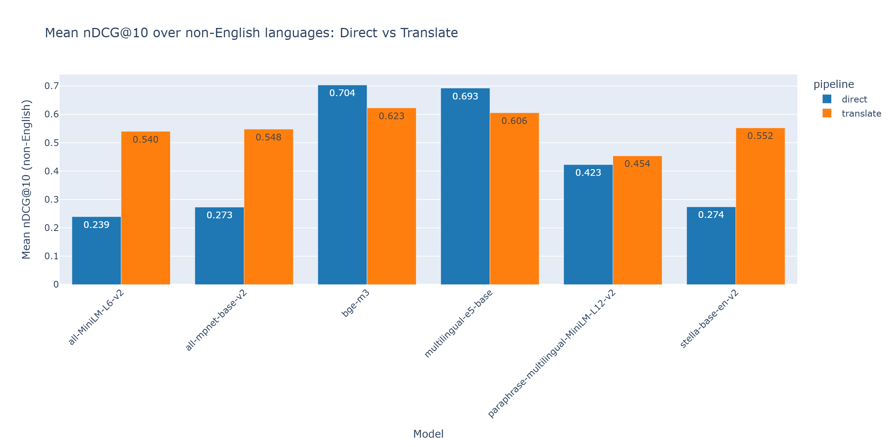
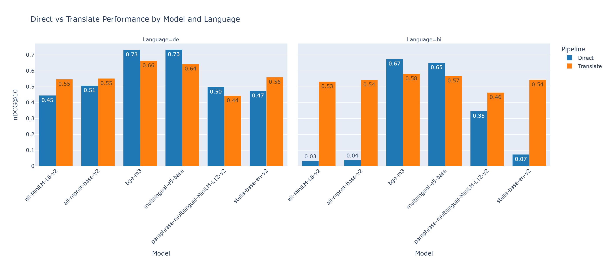

# Multilingual Retrieval: Direct vs. Translate-then-Retrieve

A comparison of two approaches to cross-lingual information retrieval — embedding documents directly in their native language versus machine-translating them to English first — across six sentence-embedding models, for German and Hindi against an English-pivot setup.

The core question: **for a given embedding model, does translating everything to English before retrieval help or hurt?** The answer depends almost entirely on whether the model was trained to be multilingual.

Evaluation uses the full corpus and query set (13,500 documents and 1,500 queries per language) with graded relevance judgments: per query there is on average one fully relevant (1.0) and eight partially relevant (0.5) documents, and nDCG is computed from those grades rather than from binary relevance.

## Results

> **Status note (November 2026).** After these results were produced, an audit found that the translation step did not give NLLB the source-language tag (a tokenizer behaviour change in transformers v5) and that long documents were only partly translated. For example, 56% of German questions starting with "Was" ("what") came back with "Was" untranslated. The **translate-pipeline numbers below are therefore provisional** and are being recomputed with a corrected translator; the direct-pipeline numbers do not use translation and are unaffected. Details: [TROUBLESHOOTING.md](TROUBLESHOOTING.md), entry 13.

Mean nDCG@10 over the two non-English languages (German and Hindi), 1,500 queries each. Both pipelines are averaged over the same languages. The English column is a reference only: English queries and documents differ from the German and Hindi ones, so it is not directly comparable.

| Model | Direct | Translate | Translate − Direct | English (direct, reference) |
|---|---|---|---|---|
| bge-m3 | **0.7035** | 0.6228 | −0.081 | 0.7842 |
| multilingual-e5-base | **0.6926** | 0.6056 | −0.087 | 0.7783 |
| paraphrase-multilingual-MiniLM-L12-v2 | 0.4229 | **0.4538** | +0.031 | 0.6477 |
| stella-base-en-v2 | 0.2741 | **0.5524** | +0.278 | 0.7670 |
| all-mpnet-base-v2 | 0.2730 | **0.5479** | +0.275 | 0.7719 |
| all-MiniLM-L6-v2 | 0.2393 | **0.5401** | +0.301 | 0.7506 |



### Findings

1. **Strong multilingual embedders do better on native text.** bge-m3 and multilingual-e5-base lose 0.08–0.09 nDCG@10 when the corpus is translated first (bge-m3: 0.732→0.664 on German, 0.675→0.582 on Hindi; multilingual-e5-base: 0.734→0.643 and 0.651→0.568). Translation discards signal these models already know how to use.
2. **English-only embedders need translation.** On native Hindi, stella-base-en-v2, all-mpnet-base-v2 and all-MiniLM-L6-v2 score 0.03–0.07, close to unusable; translation lifts them to 0.53–0.54 on the same queries. After translation their German and Hindi scores land within 0.02 of each other, so translation largely removes the language gap for these models.
3. **Translation never overtakes a good multilingual embedder.** The best English-only model on translated text (0.5524) stays well below either strong multilingual model used directly (0.69–0.70).
4. **The middle case flips by language.** paraphrase-multilingual-MiniLM-L12-v2 does better direct on German and better translated on Hindi — consistent with a multilingual model whose coverage of Hindi is thinner than of German, though this was not tested directly.

All 12 direct-vs-translate differences (6 models × 2 languages) are statistically significant: paired randomization test on per-query nDCG@10, Holm-corrected, adjusted p ≈ 0.0012 (the smallest value 10,000 permutations can give across 12 tests), and every 95% bootstrap confidence interval excludes zero (half-widths about 0.006–0.014). See `results/significance.csv`. This quantifies noise from sampling queries only; it says nothing about other datasets or translators.

Per-language detail is in `results/winloss.csv` and `results/per_language/*.csv` (precision, success, MRR and nDCG at k = 1/5/10).



Recomputing the full evaluation from the saved indices reproduced all per-language result files exactly.

## Setup

```bash
pip install -r requirements.txt
```

**If you have an NVIDIA GPU**, install a CUDA-enabled build of PyTorch explicitly — `pip install torch` alone often resolves to a CPU-only wheel even when a GPU is present, which silently makes translation and embedding dramatically slower with no error message. Check your driver's supported CUDA version with `nvidia-smi`, then install a matching build, e.g.:

```bash
pip install torch torchvision torchaudio --index-url https://download.pytorch.org/whl/cu126
```

Static chart export (`compare_results.py`) uses `kaleido`, which needs a Chrome installation (`plotly_get_chrome -y` installs one if missing).

Verify the setup:

```bash
python test_setup.py
```

## Running the pipeline

Each step is resumable: if interrupted, rerunning the same command continues from the last checkpoint instead of starting over.

```bash
# 1. Translate the non-English corpus to English (NLLB)
python translate_corpus.py --language de --translation-model nllb
python translate_corpus.py --language hi --translation-model nllb

# 2. Translate the non-English queries to English (NLLB)
python translate_queries.py --language de --translation-model nllb
python translate_queries.py --language hi --translation-model nllb

# 3. Embeddings: native corpora, then translated corpora
python generate_embeddings.py
python generate_embeddings_translated.py

# 4. Evaluate all models, both pipelines, full query set
python evaluate.py

# 5. Significance tests on direct vs translate
python significance_analysis.py

# 6. Charts
python compare_results.py --no-plots
```

Useful flags: `--model`/`--models` select specific models; `evaluate.py --force` recomputes even if results exist; `evaluate.py --summary-only` rebuilds `summary.csv` and `winloss.csv` from the existing per-language CSVs without recomputing anything; `evaluate.py --test` runs a reduced-query sanity check.

## Repo structure

```
.
├── config.yaml                          # models, languages, dataset names, k-values
├── requirements.txt
├── test_setup.py                        # environment/setup sanity check
├── verify_embeddings.py                 # confirms all embedding indices are present and correctly sized
├── utils.py                             # translation functions (single + batched)
├── translation_cache.py                 # SHA256-keyed translation cache with disk persistence
├── translate_corpus.py                  # corpus → English (batched, checkpointed, logged)
├── translate_queries.py                 # queries → English (same pattern)
├── generate_embeddings.py               # native-language embeddings → FAISS indices
├── generate_embeddings_translated.py    # translated-corpus embeddings → FAISS indices
├── evaluate.py                          # both pipelines, graded metrics, per-query output
├── significance_analysis.py             # paired randomization tests + bootstrap CIs
├── compare_results.py                   # result charts
├── embeddings/                          # FAISS indices (gitignored, regenerable)
├── translated_corpus/                   # translated documents (gitignored, regenerable)
├── translated_queries/                  # translated queries (gitignored, regenerable)
├── cache/                               # translation cache
├── results/                             # CSVs, significance table, PNG charts
├── logs/                                # timestamped run logs (gitignored)
└── audit/                               # dataset-integrity checks and hardware benchmarks
```

See [ARCHITECTURE.md](ARCHITECTURE.md) for design details and [TROUBLESHOOTING.md](TROUBLESHOOTING.md) for the bugs found and fixed along the way.

## Relation to prior work

This project was prompted by the TIFIN India system for SemEval-2025 Task 7 (Devadiga et al., 2025, *Harnessing Translation to Overcome Multilingual IR Challenges in Fact-Checked Claim Retrieval*), which translates posts to English with an LLM and retrieves with a fine-tuned English embedding model, and recommends translation plus a fine-tuned embedder over heavier post-processing. Their ablation measures the benefit of translation for one English-only embedder (Stella 400M). The comparison here asks the same question across six embedders and finds the benefit depends on the embedder: it holds for English-only models and reverses for strong multilingual ones. The two are not directly comparable — different task (fact-checked claim retrieval vs. Wikipedia retrieval), different metric (success@10 vs. graded nDCG@10), and they use LLM translation and fine-tuning, which are not used here.

## Limitations

- **Translator quality.** All translation uses NLLB-200-distilled-600M, a small model. A stronger (e.g. LLM-based) translator would likely raise the translate pipeline's scores, so the conclusion that direct beats translate for multilingual embedders is conditional on this translator.
- **Two non-English languages and one dataset.** Findings about "language dependence" rest on German and Hindi only.
- **Small collection.** 13,500 documents per language; absolute scores would be lower on larger collections.
- **No fine-tuning, reranking or hybrid search.** All embedders are used as published.
- **Significance covers query sampling only**, not translator, dataset or corpus choice.

## Future work

Extending to the other languages available in the dataset, a stronger translator as an ablation, and fine-tuning with hard negatives (an earlier version of this project scaffolded it; it was cut to keep the focus on the retrieval comparison). An interactive search demo built on the saved indices is another natural extension.
